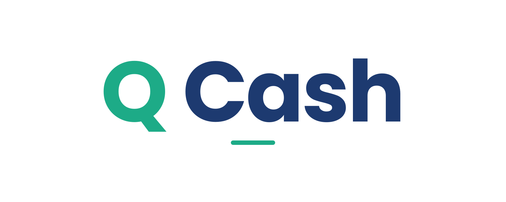

<p align="center">
  <picture>
    <source media="(prefers-color-scheme: dark)" srcset="design/qcash-logo/png/qcash-logo-on-navy.png">
    <source media="(prefers-color-scheme: light)" srcset="design/qcash-logo/png/qcash-logo-on-light.png">
    
  </picture>
</p>

# QCash Mobile

QCash is a Flutter mobile app for Kenyan micro and small businesses. It gives
business owners early access to a portion of their future Paybill revenue,
helps them manage multiple businesses, and keeps collections, repayment,
notifications, and analytics in one place.

Cash advances are interest-free. A 2% access fee is deducted upfront, the net
amount is credited to the QCash wallet, and the full advance amount is repaid.
The repayment window is up to 30 days. Repayments are collected automatically
from eligible incoming payments, with manual repayment available from the
wallet or via M-Pesa STK push.

## Screenshots

<table>
  <tr>
    <td align="center">
      
      <br><sub>Dashboard - wallet overview</sub>
    </td>
    <td align="center">
      
      <br><sub>Cash advance breakdown</sub>
    </td>
    <td align="center">
      
      <br><sub>Notifications</sub>
    </td>
  </tr>
  <tr>
    <td align="center">
      
      <br><sub>M-Pesa collection details</sub>
    </td>
    <td align="center">
      
      <br><sub>Repayment progress</sub>
    </td>
    <td align="center"></td>
  </tr>
</table>

## Features

- Phone number registration with SMS OTP verification
- Login with optional two-factor authentication
- Multiple businesses per user, with a business switcher and management screen
- Shared QCash Paybill with a unique collection account number per business
- Business wallet with withdrawals and M-Pesa collection details
- Cash advance eligibility, terms, and automatic wallet disbursement
- Automatic repayment from eligible incoming payments
- Early repayment from the QCash wallet or directly via M-Pesa STK push
- Live notification inbox and unread badge
- Revenue analytics with monthly and daily charts
- Profile, personal information, security, and appearance settings
- Light, dark, and system theme modes
- Dark-mode-aware custom design system

## Tech stack

- Flutter 3.47.8 / Dart 3.13.7
- Riverpod for state management
- Dio for HTTP
- SharedPreferences for local persistence
- Laravel API backend at an `/api` base URL

## Getting started

### Prerequisites

- Flutter SDK 3.47.8 or newer in the 3.x stable channel
- Android Studio or Xcode for the target platform
- A running QCash API backend

Check your Flutter installation:

```bash
flutter doctor
flutter --version
```

### Install dependencies

```bash
flutter pub get
```

### Configure the API

The app reads its API base URL from `API_BASE_URL`. The value must include the
`/api` suffix.

```bash
flutter run --dart-define=API_BASE_URL=http://YOUR_HOST:8000/api
```

Examples:

```bash
# Android emulator
flutter run --dart-define=API_BASE_URL=http://10.0.2.2:8000/api

# iOS simulator
flutter run --dart-define=API_BASE_URL=http://127.0.0.1:8000/api

# Physical device on the same network
flutter run --dart-define=API_BASE_URL=http://192.168.1.20:8000/api
```

For local HTTP development, make sure the device/emulator can reach the backend
and that the backend allows requests from the app.

### Run

```bash
flutter run
```

With an explicit API URL:

```bash
flutter run --dart-define=API_BASE_URL=https://your-api.example.com/api
```

### Analyze and test

```bash
flutter analyze
flutter test
```

### Build

```bash
flutter build apk --release \
  --dart-define=API_BASE_URL=https://your-api.example.com/api
```

```bash
flutter build ios --release \
  --dart-define=API_BASE_URL=https://your-api.example.com/api
```

The repository also includes an unsigned iOS CI workflow at
`.github/workflows/ios-build.yml`.

## Project structure

```text
lib/
  core/          API client, models, repositories, providers, formatting
  screens/       Auth, home, financial, access, revenue, account, onboarding
  theme/         Brand colors, light/dark themes, palette extension
  widgets/       Shared buttons, fields, cards, navigation, OTP input
design/          Logo variants, screenshots, SVGs, and wireframes
assets/images/   Runtime image assets used by the app
test/            Unit and widget tests
```

## Design assets

- Logo variants: `design/qcash-logo/` (PNG and JPG, light/navy/green variants)
- App screenshots: `design/App Screenshots/`
- Wireframes and SVG references: `design/`

The README logo is loaded directly from `design/qcash-logo/png/`. Runtime copies
of the logo used inside the app live in `assets/images/`.

## Main flows

### Cash advance

1. QCash assesses eligible Paybill history; new businesses need at least 14 days
   of eligible transactions.
2. The advance amount, 2% access fee, net wallet credit, and full repayment
   amount are shown before accepting.
3. Accepting the advance approves and disburses it directly to the QCash wallet.
4. The advance is repaid automatically from eligible incoming payments, or early
   from the wallet or M-Pesa.

### Repayment

- Automatic deductions apply to eligible incoming payments while an advance is
  outstanding.
- Overdue and oldest advances are cleared first.
- Manual repayment supports the wallet and M-Pesa STK push, including a
  one-tap option to use the full outstanding amount.

### Notifications

- Advance disbursements, repayments, withdrawals, and payment events appear in
  the in-app notification inbox.
- The inbox refreshes when opened and polls in the background while visible.

## Support

For product questions or account issues, use the Help & Support screen in the
app.
